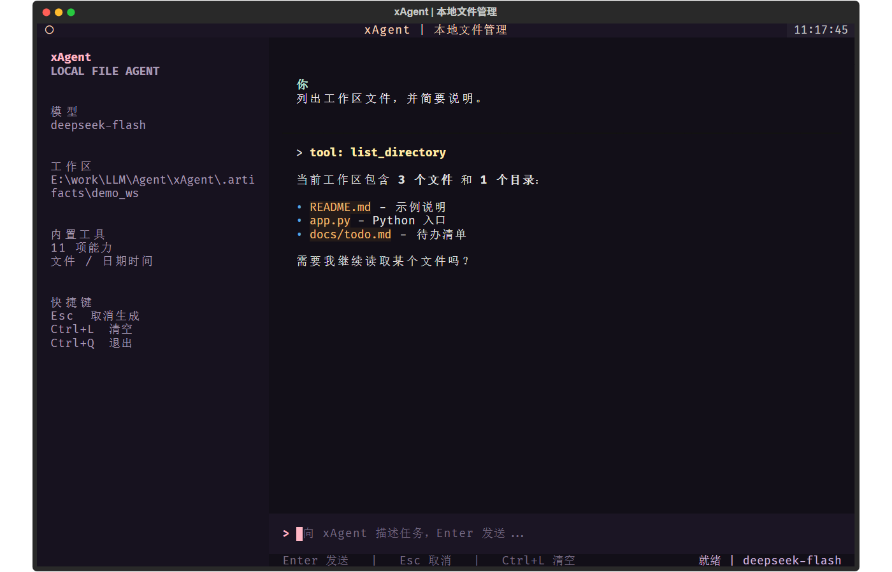

# xAgent

一个基于 **Textual** 的本地文件管理智能体。项目由原来的单文件
`practice02/chat_file_tools.py` 重构而来，核心目标是把 **业务核心（core）**
与 **终端界面（tui）** 彻底解耦，同时为后续开发 Web / Desktop 客户端预留稳定接口。



## 特性

- **Core / UI 分离**：`core` 不依赖 Textual、Rich，也不读写终端；`tui` 不直接操作文件或调用模型。
- **事件流驱动**：核心通过 `AgentEvent` 异步流输出文本、工具调用、完成和错误状态；
  Textual、WebSocket、桌面端可以消费同一套事件。
- **10 个文件工具 + 时间工具（含闰年判定）+ `readExternalFile` 工作区外只读 + `fetchWeb` 网页抓取 +
  `searchweb` 网络搜索 + `Runcil` 本地命令行 + `loadSkill` / `createSkill` +
  `getContextStats` / `recallContext`**（完整清单见下方表格，共 21 个工具）；
  普通文件操作限制在工作区内，`readExternalFile` 只提供用户明确要求时的只读例外。
- **启动时从上游读取上下文窗口**：每次启动请求当前模型的 `/models` 元数据，
  读取 `context_window` 并写入状态栏与会话统计；上游没有返回时按 **128k 默认**
  计算占比，并在界面明确标注「默认」，不把默认值伪装成上游数据。
- **上下文用量状态栏**：对话框下方和侧栏实时显示 `当前上下文 / 模型窗口`
  （如 `12.3k / 128k 默认  10%`）、Prompt 缓存命中 / 未命中与命中率、消息数；
  供应商返回 `usage` 时使用精确值，否则用本地估算并标注 `~`。`/context`
  可查看完整明细。
- **上下文压缩与历史归档**：占用达到窗口 **80%** 时提示并暂停接受普通提示词；
  用户执行 `/compact` 后，先把完整原始上下文写入 `.agents/context/<编号>.jsonl`，
  再让模型生成约 5,000 Tokens 的摘要替换历史，并弹出压缩前后两栏对照面板。
- **会话持久化与恢复**：`/save` 把会话写入 `.agents/sessions/<编号>.jsonl`
  事件日志；`/new` 自动保存当前会话并开始新会话；`/resume` 弹出历史会话列表
  （↑↓ 选择、Enter 恢复、Esc 取消）；`/quit` 退出时按配置自动保存。
- **AGENTS.md 一次注入**：会话首次加载时读取项目根目录的 `AGENTS.md`，作为一条
  历史消息注入并随会话日志持久化，后续轮次和恢复会话直接复用，避免破坏缓存。
- **异步 MCP 加载**：先渲染 TUI，再在后台连接 MCP Server；侧栏实时显示每个
  服务器的连接状态和可用工具，加载完成后只刷新该区域，不阻塞首屏。
- **配置即插即用**：所有可调参数集中在 `config.ini`（含默认值）；当前目录没有
  配置文件时自动生成完整模板并弹出对话框，提示修改后重启。
- **斜杠工具菜单**：输入单个 `/` 自动在输入框上方弹出工具列表，继续输入可过滤，
  `↑↓` 选择、`Enter` 确认、`Esc` 关闭。内置 `/new`、`/resume`、`/save`、
  `/compact`、`/refine`、`/review`、`/init`，以及 `/mcp`、`/agents`、`/session`
  等会话与诊断命令。
- **MCP Client**：启动时读取当前项目目录下的 `.mcp.json`，连接 **stdio** 和
  **Streamable HTTP** 两种 MCP Server，调用 `list_tools()` 自动发现工具并注册到
  现有 Function Calling 工具集合；工具名带服务器前缀，调用结果（文本、结构化数据、
  错误）原样回传给模型。单个服务器不可用时只提示错误，不影响本地工具和其他服务器。
- **工作区沙箱**：普通文件操作统一经过 `Workspace.resolve()` 校验，禁止访问工作区
  之外的文件；只有显式的只读工具 `readExternalFile` 可以在用户明确要求时读取
  工作区外的纯文本文件。
- **工具调用循环**：自动处理模型的多轮 function calling，**默认不限制单轮工具轮数**，
  直到模型完成回答或用户按 Esc 取消；工具错误回传给模型，不会中断界面。
- **流式 TUI**：Markdown 增量渲染、工具调用默认折叠卡片（点击标题展开参数与结果）、
  状态栏、取消生成、清空会话。
- **运行时系统提示词**：启动后会在会话区以**折叠**形式放置本轮实际使用的系统提示词
  （含工作区与 Skill 清单），点击标题或按 Enter 即可展开/收起；`/system` 可随时切换。
- **焦点恢复重排**：窗口失焦或后台生成后重新激活时，强制重新布局会话并回到底部。
- **opencode 风格输入区**：无边框 composer、`>` 提示符、马卡龙粉光标，支持 `Ctrl+V` 直接粘贴系统剪贴板。
- **中文命令面板**：`Ctrl+P` 打开，命令、搜索提示和空结果提示全部为中文。
- **马卡龙配色**：消息与工具调用不使用整块背景，仅用薄荷绿、奶油黄、粉色和淡紫做文字强调。
- **终端宽度安全**：不使用 box-drawing 边框；Windows `cmd.exe` 启动时自动切换黑体，
  避免中英文混排造成边框/表格错位。
- **可配置限额**：可选的单轮工具轮数上限（默认不限制）、文本读取上限、目录列出的最大条目数。
- **安全默认值**：API Key 不会进入 `repr`、日志或 UI 事件；`config.ini` 已被 Git 忽略。
- **核心与 UI 解耦**：工具、Agent、配置均可在无终端环境下构建，TUI 只消费 `AgentEvent`。

## 工具清单（共 21 个）

模型可调用的全部工具都由 `core/tools/specs.py` 声明、由对应的工具类实现，
`ToolRegistry` 在构造时校验"声明与实现一一对应"，缺一不可。

| # | 工具 | 类别 | 说明 | 只读 |
| --- | --- | --- | --- | --- |
| 1 | `get_current_directory` | 时间 / 环境 | 返回受控工作区的绝对路径 | ✅ |
| 2 | `get_current_datetime` | 时间 / 环境 | 当前日期、时间、星期、时区与 UTC | ✅ |
| 3 | `is_leap_year` | 时间 / 环境 | 闰年判定（4 / 100 / 400 规则），缺省用当前年份 | ✅ |
| 4 | `list_directory` | 文件 | 列出目录项，可递归，带大小与修改时间 | ✅ |
| 5 | `get_file_type` | 文件 | 扩展名、MIME、文本/二进制、编码、魔数 | ✅ |
| 6 | `read_text_file` | 文件 | 读纯文本，识别编码并截断 | ✅ |
| 7 | `create_file` | 文件 | 原子创建文件，默认不覆盖 | ❌ |
| 8 | `edit_text_file` | 文件 | overwrite / append / replace 三种模式 | ❌ |
| 9 | `create_directory` | 文件 | 创建目录，默认递归建父目录 | ❌ |
| 10 | `delete_directory` | 文件 | 递归删除目录（支持非空） | ❌ |
| 11 | `delete_file` | 文件 | 删除文件 | ❌ |
| 12 | `rename_path` | 文件 | 重命名文件或目录（兼容 Windows 仅改大小写） | ❌ |
| 13 | `readExternalFile` | 文件 | 只读读取工作区之外的纯文本（需用户明确要求） | ✅ |
| 14 | `fetchWeb` | 网络 | curl 抓取 + trafilatura 转 Markdown | ✅ |
| 15 | `searchweb` | 网络 | 百度千帆 AI 搜索（摘要 + 标题 + URL） | ✅ |
| 16 | `Runcil` | 系统 | 以参数列表方式执行本机 CLI，返回 stdout/stderr/退出码 | ❌ |
| 17 | `loadSkill` | 技能 | 按需加载 SKILL.md 或技能内附件（限制在技能目录内） | ✅ |
| 18 | `createSkill` | 技能 | 创建 `.agents/skills/<slug>/SKILL.md`，拒绝覆盖 | ❌ |
| 19 | `createMcp` | MCP | 校验并合并写入 `.mcp.json` | ❌ |
| 20 | `getContextStats` | 上下文 | token / 窗口占用 / 缓存命中统计 | ✅ |
| 21 | `recallContext` | 上下文 | 在压缩前的历史归档里做本地关键词检索 | ✅ |

另外，MCP Client 会把外部服务器的工具以前缀 `<服务器名>__<工具名>` 动态注册进同一集合，
它们不占用上表的固定编号。

## 目录结构

```text
xAgent/
├─ core/                         # 业务核心：无终端、无 UI 依赖
│  ├─ __init__.py                # 对外公共 API
│  ├─ agent.py                   # 对话编排 + 工具循环 + 压缩流程
│  ├─ archive.py                 # 上下文归档（JSONL）与本地关键词检索
│  ├─ bootstrap.py               # 组合根：配置 -> Agent
│  ├─ compaction.py              # 压缩 Prompt、摘要消息与归档说明
│  ├─ config.py                  # config.ini / 环境变量 / 限额
│  ├─ context.py                 # 上下文 token / 缓存用量跟踪 + 80% 阈值
│  ├─ errors.py                  # 领域异常
│  ├─ events.py                  # UI 无关的领域事件（显示协议）
│  ├─ models.py                  # 供应商无关的消息/分片结构
│  ├─ mcp/
│  │  ├─ config.py               # .mcp.json 解析与环境变量展开
│  │  ├─ manager.py              # MCP 连接、工具发现、调用转发
│  │  └─ tools.py                # 工具命名映射与结果格式化
│  ├─ ports.py                   # ChatModel 抽象端口
│  ├─ prompts.py                 # 系统提示词（含 Skill 列表与项目指令规则）
│  ├─ session.py                 # 会话事件日志、AGENTS.md 读取与注入消息
│  ├─ skills.py                  # Agent Skills 发现与 Frontmatter 解析
│  ├─ llm/
│  │  └─ openai_chat.py          # OpenAI 兼容流式适配器
│  └─ tools/
│     ├─ filesystem.py           # 10 个文件工具 + 时间工具的实现
│     ├─ context.py              # 上下文统计 + 归档检索（getContextStats、recallContext）
│     ├─ external.py             # 工作区外只读读取（readExternalFile）
│     ├─ web.py                  # curl 抓取 + trafilatura 正文提取（fetchWeb）
│     ├─ search.py               # 百度千帆 AI 搜索（searchweb）
│     ├─ runcli.py               # 本地命令行执行（Runcil）
│     ├─ skills.py               # 按需加载 / 创建 Skill（loadSkill、createSkill）
│     ├─ mcpconfig.py            # 写入 MCP 配置（createMcp）
│     ├─ paths.py                # 工作区路径策略与名称校验
│     ├─ registry.py             # 工具注册、JSON 参数校验、异常隔离
│     ├─ specs.py                # 工具 JSON Schema 声明（文件 / 网页 / 搜索 / 命令行 / Skill / MCP / 上下文）
│     └─ types.py                # ToolSpec / ToolResult
├─ tui/                          # Textual 表现层
│  ├─ app.py                     # 布局、输入、事件消费、生命周期
│  ├─ widgets.py                 # 消息/工具卡片、上下文栏、斜杠菜单组件
│  ├─ slash.py                   # 斜杠命令元数据、过滤与提示词模板
│  ├─ formatting.py              # 纯展示格式化 + 宽度安全字符处理
│  ├─ clipboard.py               # 系统剪贴板读取（Windows / tkinter）
│  ├─ palette.py                 # 全中文命令面板
│  ├─ terminal.py                # Windows 控制台字体切换（黑体）
│  ├─ styles.tcss                # Textual 主题（无 box-drawing 边框）
│  ├─ dialog.py                  # 启动阶段对话框（配置已生成等）
│  ├─ cli.py                     # 命令行入口
│  └─ __main__.py                # python -m tui
├─ docs/
│  ├─ architecture.md            # 分层设计与扩展指南
│  └─ tui-preview.png
├─ config.example.ini
├─ config.ini                    # 本机真实配置，已被 .gitignore 忽略
├─ .mcp.json                     # MCP Server 连接配置（可选，置于启动目录）
├─ pyproject.toml
└─ README.md
```

## 快速开始

要求 Python 3.11+，并确保系统 `PATH` 中有 `curl`（Windows 10+ 自带 `curl.exe`）。

```powershell
cd Agent/xAgent   # 在本仓库根目录执行

# 首次运行：创建虚拟环境并安装
py -3.11 -m venv .venv
.\.venv\Scripts\python.exe -m pip install -e ".[dev]"

# 配置 API Key
Copy-Item config.example.ini config.ini
# 编辑 config.ini，填入 [llm] api_key
# 如需联网搜索，再填入 [search] baidu_qianfan_api_key
# 也可以直接启动：当前目录没有 config.ini 时会自动生成完整模板，
# 弹窗提示你修改 api_key 后重新启动。

# 可选：在启动 xAgent 的目录创建 .mcp.json（见“外部 MCP Server”一节）
```

启动：

```powershell
# 工作区默认为当前目录
.\.venv\Scripts\xagent.exe

# 或显式指定工作区 / 配置文件 / MCP 配置
.\.venv\Scripts\xagent.exe --workspace D:\projects\demo
.\.venv\Scripts\xagent.exe --config .\config.ini --workspace .\demo
.\.venv\Scripts\xagent.exe --mcp-config D:\projects\demo\.mcp.json
.\.venv\Scripts\xagent.exe --no-mcp

# 也可以模块方式启动
.\.venv\Scripts\python.exe -m tui -w D:\projects\demo
```

安装后也可以直接使用 `xagent` 命令（前提是虚拟环境已激活）。

## 配置

所有可调参数都集中在 `config.ini`，完整模板见 `config.example.ini`。启动时按
以下顺序查找配置：

1. 命令行 `--config FILE`；
2. `XAGENT_CONFIG` 环境变量；
3. **当前目录**的 `config.ini`；
4. 都没有时，**在当前目录自动生成一份完整模板**，弹窗提示用户填写
   `[llm] api_key` 后重新启动，然后退出。

每一项都有内置默认值，缺少某个小节或某一项不会导致启动失败。主要参数：

| 小节 | 参数 | 说明 |
| --- | --- | --- |
| `[llm]` | `api_key` / `base_url` / `model` / `timeout_seconds` | 模型连接 |
| `[agent]` | `max_tool_rounds` / `max_text_bytes` / `default_max_chars` / `max_list_items` | 工具循环与读取限额 |
| `[context]` | `default_window`（128k）/ `warning_ratio`（0.8）/ `summary_tokens`（5000）/ `archive_dir` / `max_recall_hits` / `max_recall_chars` / 各类 transcript 上限 | 上下文监控、压缩与检索 |
| `[sessions]` | `directory` / `save_on_exit` / `auto_save_on_new` / `max_list` / `agents_file` / `inject_agents_md` / `max_agents_md_chars` | 会话日志与 AGENTS.md |
| `[tui]` | `max_tool_output_chars` / `max_tool_arguments_chars` / `mcp_max_tools` | 界面展示 |
| `[tools]` | `runcli_timeout_seconds` / `runcli_max_output_chars` / `web_timeout_seconds` / `web_max_download_bytes` / `search_max_response_bytes` / `model_info_timeout_seconds` | 本地工具、抓取与元数据查询 |
| `[search]` | `baidu_qianfan_api_key` / `api_url` / `top_k` / `timeout_seconds` | 百度千帆搜索 |
| `[mcp]` | `enabled` / `config_path` / `connect_timeout` / `call_timeout` / `max_result_chars` / `shutdown_timeout` | MCP 连接 |
| `[logs]` | `enabled` / `level` / `directory` / `max_bytes` / `backup_count` | 调用日志落盘 |

环境变量优先级高于配置文件：

| 环境变量 | 说明 |
| --- | --- |
| `XAGENT_API_KEY` | API Key（也兼容 `DEEPSEEK_API_KEY`、`OPENAI_API_KEY`） |
| `XAGENT_BASE_URL` | OpenAI 兼容接口地址 |
| `XAGENT_MODEL` | 模型名 |
| `XAGENT_WORKSPACE` | 默认工作区 |
| `XAGENT_CONFIG` | 配置文件路径 |
| `XAGENT_BAIDU_QIANFAN_API_KEY` | 百度千帆搜索 API Key（也兼容 `BAIDU_QIANFAN_API_KEY`） |
| `XAGENT_SEARCH_ENDPOINT` | 自定义搜索接口地址 |
| `XAGENT_CONSOLE_FONT` | cmd.exe 自动切换的控制台字体，默认 `黑体` |
| `XAGENT_NO_FONT_SETUP` | 设为 `1` 时禁止自动修改控制台字体 |
| `XAGENT_MCP_ENABLED` | 设为 `0` / `false` 时本次启动不连接 MCP Server |
| `XAGENT_MCP_CONFIG` | MCP 配置文件路径，默认 `<启动目录>/.mcp.json` |
| `XAGENT_MCP_CONNECT_TIMEOUT` | 单个 MCP Server 连接/工具发现超时秒数，默认 20 |
| `XAGENT_MCP_CALL_TIMEOUT` | 单次 MCP 工具调用超时秒数，默认 60 |
| `XAGENT_MCP_MAX_RESULT_CHARS` | 单个 MCP 工具结果保留的最大字符数，默认 30000 |

优先级：命令行参数 > 环境变量 > `config.ini` > 默认值。API Key 只保存在核心配置对象中，
`LLMSettings` 的 `repr` 已隐藏该字段。

## 网页抓取（fetchWeb）

模型在需要阅读、总结或分析网页时会调用 `fetchWeb`：

```json
{"url": "https://example.com/article"}
```

执行流程：

1. 用参数列表方式启动本地 `curl`（不经过 shell），下载 HTML 源码；
2. 用 `trafilatura` 提取正文并转换为 Markdown，保留标题、段落、列表、表格和链接；
3. 返回原始 URL、网页标题和 Markdown 正文。

安全与限额：仅允许 `http/https`，重定向同样限制在 `http/https`；连接超时 10 秒、
总超时 20 秒、下载上限 10 MB。正文超过 `default_max_chars`（默认 50000 字符）时会截断。
访问失败、超时、内容类型不是 HTML、HTML 解析失败或正文为空时，工具会返回明确的错误信息，
由模型转告用户，不会中断会话。

## 网络搜索（searchweb）

当用户询问新闻、天气、价格、赛事等时效性信息，或模型不确定某个最新事实时，
会调用 `searchweb` 获取互联网信息：

```json
{"query": "北京今日天气与出行建议"}
```

执行流程：

1. 从 `config.ini` 的 `[search] baidu_qianfan_api_key`（或环境变量
   `XAGENT_BAIDU_QIANFAN_API_KEY`）读取 API Key，不使用任何硬编码密钥；
2. 调用百度千帆 AI 搜索接口
   `https://qianfan.baidubce.com/v2/ai_search/web_search`，
   请求网页结果 `top_k` 条（默认 10，范围 1-50）；
3. 把返回的搜索摘要、来源标题、URL 和发布时间整理成纯文本返回给模型。

配置项：

| 键 | 说明 |
| --- | --- |
| `baidu_qianfan_api_key` | 必填，百度千帆 API Key；留空时 Agent 仍可启动 |
| `api_url` | 可选，搜索接口地址 |
| `top_k` | 可选，网页结果条数，默认 10 |
| `timeout_seconds` | 可选，请求超时秒数，默认 20 |

容错行为：未配置 Key、Key 无效、网络不可达、请求超时、HTTP 非 2xx、
API 返回业务错误、响应不是合法 JSON、返回结果为空时，工具都会通过
Function Calling 的结果向模型返回可读的错误信息，由模型转告用户，
不会中断会话，也不会把 API Key 写入日志或 UI。

## 启动时获取模型上下文窗口

xAgent **不依赖本地配置猜测上下文窗口**。每次启动都会用当前 `[llm]` 的
`base_url`、`api_key` 和 `model` 请求上游的 OpenAI 兼容模型列表：

1. 请求 `GET {base_url}/models`；如果 `base_url` 以 `/v1` 结尾，还会兼容
   `GET {origin}/models`；
2. 按模型 id 找到当前模型，读取 `context_window`、`context_length`、
   `max_model_len`、`max_input_tokens`、`n_ctx` 等常见字段，也支持
   OpenRouter 风格的 `top_provider.context_length` 嵌套字段；
3. 列表接口没有上下文长度时，再尝试 `GET {base_url}/models/{model}`；
4. 成功时把窗口写入会话的 `ContextTracker`，侧栏显示如
   `上下文窗口 1.0M tok（上游获取）`，会话区启动提示和 `/model` 显示完整数值与
   实际请求的上游地址；
5. 上游没有返回该字段或网络失败时，界面按 **128k** 计算占比并标注「默认」，
   例如 `上下文 12.3k / 128k 默认  9%`；不会把 65536 之类的本地猜测值伪装成
   上游数据，`/model` 仍会说明上游查询失败的原因。

请求使用 `Authorization: Bearer <api_key>`，只读取模型元数据，不发送对话内容；
错误信息只包含 HTTP 状态或连接原因，不会写入 API Key。

## 上下文与缓存用量（getContextStats）

对话框下方始终显示一行上下文状态，侧栏也会显示同样的大小 / 窗口 / 占比：

```text
上下文 ~12.3k / 1.0M  1%   |   缓存 命中 8.2k / 未命中 4.1k (66%)   |   消息 8
```

- **上下文**：当前对话（含系统提示词、用户输入、工具调用与工具结果）的 token
  数 / 模型窗口大小与占比；模型供应商返回 `usage` 时 token 数是精确值，没有
  返回时显示 `~` 表示本地估算。窗口来自上游模型信息，上游没有提供时显示
  `128k 默认`。
- **缓存**：本次会话累计的 Prompt 缓存命中 / 未命中 token 与命中率。数据来自
  DeepSeek 的 `prompt_cache_hit_tokens` / `prompt_cache_miss_tokens`，或 OpenAI
  兼容接口的 `prompt_tokens_details.cached_tokens`；供应商不返回缓存字段时显示
  “无数据”，不会把未知值当成 0。
- **消息**：当前历史中的消息条数。

适配器使用 `stream_options={"include_usage": true}` 请求流式用量；少数不支持该
参数的 OpenAI 兼容服务会自动回退为普通流式请求，此时状态栏改用本地估算。
上下文占用达到窗口的 **80%** 时，状态栏、侧栏和会话区会提示执行 `/compact`，
并暂停接受新的普通提示词，直到压缩成功（斜杠命令仍然可用，否则无法压缩）。
阈值 `context.warning_ratio`、默认窗口 `context.default_window`、摘要目标
`context.summary_tokens` 都可以在 `config.ini` 中调整。

`/context` 命令（或命令面板“查看上下文用量”）会在会话区输出详细数据：最近一次
请求的输入 / 输出 / 推理 token、最近一次缓存命中、会话累计 token 与请求次数。
模型需要判断是否接近上下文上限时，也可以调用 `getContextStats` 获取同样的统计。

## 斜杠工具菜单（/）

在输入框输入单个 `/`，composer 上方会弹出工具列表；继续输入会按命令名、标题、
描述和关键词实时过滤。`↑` / `↓` 移动高亮，`Enter` 确认，`Esc` 关闭菜单
（不会取消正在生成的回复）。也可以直接输入完整命令后回车。

| 命令 | 行为 |
| --- | --- |
| `/new` | 自动保存当前会话并开始一个新会话（`/newsession` 同义） |
| `/resume` | 弹出历史会话列表：↑↓ 选择、Enter 恢复、Esc 取消（`/sessions`、`/history` 同义） |
| `/save` | 把当前会话写入 `.agents/sessions/<编号>.jsonl` 事件日志 |
| `/session` | 显示当前会话编号、标题、消息数、日志路径与目录 |
| `/rename <标题>` | 修改当前会话在历史列表中的标题 |
| `/compact` | 先归档原始上下文，再调用模型生成约 5,000 Tokens 摘要替换历史（`/summarize`、`/compress` 同义） |
| `/mcp` | 显示 MCP 服务器连接状态与每个服务器的可用工具 |
| `/agents` | 查看 AGENTS.md 的路径、字符数与注入状态 |
| `/refine <提示词>` | 调用模型润色提示词；结果回填输入框，由用户确认后再发送（`/polish` 同义） |
| `/review [重点]` | 填入代码审查提示词，可补充审查重点，编辑后发送 |
| `/init [要求]` | 填入扫描项目并生成/更新 `AGENTS.md` 的提示词 |
| `/context` | 上下文窗口、最近请求与缓存命中明细 |
| `/cost` | 本次会话累计输入 / 输出 / 缓存消耗（`/usage` 同义） |
| `/model` | 当前模型、接口地址与上下文窗口 |
| `/tools` | 列出模型可调用的全部 Function Calling 工具 |
| `/help` | 命令与快捷键帮助 |
| `/workspace` | 当前工作区路径 |
| `/system` | 展开或收起系统提示词 |
| `/clear` | 清空当前会话的界面、对话历史与用量统计（保留会话编号与 AGENTS.md） |
| `/cancel` | 取消当前生成 |
| `/quit` | 退出 xAgent（`/exit` 同义）；按配置自动保存当前会话 |

### 会话保存、恢复与 `/new`

每个会话对应 `.agents/sessions/<YYYYMMDD-HHMMSS>.jsonl` 事件日志：

- 第一行是会话头（编号、创建/更新时间、标题、工作区、AGENTS.md 路径）；
- 之后每条消息一行事件，保留角色、正文、工具调用参数、工具结果和顺序；
- 写入采用「临时文件 + 原子替换」，进程中断不会留下半个会话。

`/save` 显式保存；`/new` 先自动保存再切换新编号；`/resume` 读取目录下的日志，
按更新时间倒序显示标题、编号、消息数和时间，选中后重建对话历史（System Prompt
使用当前配置，其余消息原样恢复）。`/quit` 是否自动保存由 `sessions.save_on_exit`
控制，`/new` 的自动保存由 `sessions.auto_save_on_new` 控制。

### AGENTS.md（一次注入，全程复用）

启动时如果项目根目录存在 `AGENTS.md`（文件名可通过 `sessions.agents_file`
修改），xAgent 会在会话首次加载时把它作为**一条历史消息**追加到对话中，并在
会话日志里持久化。后续轮次、`/compact` 压缩后以及 `/resume` 恢复时都直接复用
这条消息（压缩会把 AGENTS.md 消息原样保留在新历史最前面），不会重复注入，
从而保证 Prompt 缓存稳定。`/new` 会重新读取一次文件，适合在修改 AGENTS.md 后
开始新会话。关闭注入可设置 `sessions.inject_agents_md = false`，内容长度上限由
`max_agents_md_chars` 控制。


### 上下文压缩、归档与检索（/compact + recallContext）

上下文占用达到窗口的 **80%** 后，xAgent 会提示执行 `/compact` 并暂停接受新的
普通提示词（斜杠命令仍可使用）。`/compact` 的执行顺序是固定的：

1. **先归档**：把当前完整上下文（System Prompt、用户消息、助手回复、工具调用
   参数、工具返回结果和顺序）写入项目本地的
   `.agents/context/<归档编号>.jsonl`，一行一条消息，例如
   `.agents/context/20261022-153000.jsonl`。编号为 `YYYYMMDD-HHMMSS`，同一秒
   重复时追加 `-2`。归档采用「临时文件 + 原子替换」，**只有归档成功才会继续
   压缩**；失败时直接报错，历史保持不变。
2. **再摘要**：使用专用的上下文压缩 Prompt，把历史整理成约 5,000 Tokens 的
   Markdown 工作摘要，重点保留用户目标、已完成工作、当前状态、关键技术信息、
   关键决策和下一步任务。压缩请求**不携带任何工具**，因此压缩期间不会触发其他
   Function Calling，也不会继续处理原有任务。
3. **后替换**：System Prompt 和工具定义保持不变，摘要作为唯一的 user 消息写入
   新历史，末尾追加归档说明（例如“此前上下文已于 2026-10-22 15:30:00 完成压缩，
   原始上下文保存在编号为 20261022-153000 的归档文件中……请使用 recallContext
   工具”），再加一条简短的 assistant 确认。压缩后的历史控制在约 5,000 Tokens。
4. **对照面板**：压缩成功后弹出浮动面板，左栏显示压缩前原文、右栏显示压缩后
   摘要，两栏都可以滚动，按 `Esc` 或点击「关闭」按钮退出。
5. **失败回退**：模型没有返回摘要、请求失败或被取消时，保留原有上下文并报告
   错误，可以重新执行 `/compact`。

压缩成功后会解除输入限制，状态栏立即刷新为压缩后的规模。已经发生的 token /
缓存消耗继续计入会话累计。会话区仍然保留压缩前的历史展示，方便回看。

模型在后续对话中发现摘要缺少早期细节时，可以调用 `recallContext`：

```json
{"text": "estimate_text_tokens", "id": "20261022-153000"}
```

- `text`（必需）：关键词，可以用空格分隔多个词；
- `id`（可选）：只检索指定归档；省略时检索 `.agents/context/` 下的所有归档。

检索是纯本地的全文关键词匹配（不使用向量数据库或 Embedding）：逐行读取 JSONL，
对消息正文、工具调用参数和工具结果做大小写无关的匹配，按「命中关键词数 + 出现
次数」排序，返回归档编号、消息位置、角色和一段带上下文的片段。单次最多返回 6 条、
总计约 4,000 字符，避免检索结果再次占满上下文；命中过多时会提示缩小关键词。

### 提示词润色（/refine）

`/refine 帮我看看这个文件` 会调用模型把草稿改写成更清晰、具体、可执行的提示词，
保留原意，不回答草稿本身的问题。润色结果只回填输入框，不写入对话历史，也不会
自动发送；失败时输入框会恢复原始草稿。先输入 `/` 再选择“润色提示词”时，菜单会
自动把 `/refine ` 填入输入框，等用户补充内容后再回车。

### 设计参考

斜杠菜单和命令命名参考了主流 CLI Agent 的常见交互：

- Cursor CLI 的 `/summarize`（`/compress` 别名）、`/model`、`/clear`、`/mcp`
  等命令；
- opencode 的 `/compact`、`/init`、`/new`、`/help` 等命令；
- Claude Code 的 `/compact`、`/review`、`/cost`、`/context` 等命令。

参考链接：[Cursor Slash commands](https://cursor.com/docs/cli/reference/slash-commands)、
[opencode CLI](https://opencode.ai/docs/cli/)、
[Claude Code Commands](https://code.claude.com/docs/en/commands)。

## 本地命令行（Runcil）

模型需要运行本机已经安装的 CLI（如 `git`、`python`、`ffmpeg`）时，会调用 `Runcil`：

```json
{"command": "git", "args": ["status", "--short"]}
```

执行流程：

1. `command` 与 `args` 被组装为参数列表，通过
   `subprocess.run([...], shell=False)` 执行，不会把程序名或参数拼成 shell 命令字符串；
2. 命令以运行 xAgent 的当前用户权限、在 Agent 当前工作区下执行；标准输入被置空，
   因此需要交互输入的程序会直接读到 EOF 或等待到超时；
3. 工具返回命令、退出码、执行状态、标准输出和标准错误。退出码非 0 时，
   模型会结合 stderr 判断失败原因并决定下一步；
4. 默认执行超时 **30 秒**，超时会终止进程并回传超时前已捕获的输出；
5. stdout 和 stderr 各自超过 **10000 字符**时只保留前 10000 字符，
   并明确标注截断及未显示的字符数，避免终端输出占满上下文。

安全说明：本阶段按教学要求**不实现命令白名单、黑名单或审批机制**，任意已安装的
程序都可能被执行，且命令拥有与 xAgent 相同的用户权限和文件访问能力。该功能仅用于
受控教学实验环境，不应在不受信任的输入或生产环境中直接启用。

> `dir`、`cd`、`echo` 等由 Shell 内建提供的命令不是独立可执行程序，不能直接运行；
> 请改用对应的独立程序，或显式调用 `cmd /c ...`、`powershell -Command ...`。

## 外部 MCP Server（MCP Client）

xAgent 实现了 MCP Client：启动时连接外部 MCP Server，把服务器提供的工具注册为
普通 Function Calling 工具，与 `Runcil`、`fetchWeb`、`loadSkill` 等本地工具统一参与
Agent 的工具调用流程。

### 异步加载与侧栏状态

TUI 不再等待 MCP 连接完成：`build_agent` 只创建管理器，`FileAgent` 在首屏渲染后
通过 `start_mcp()` 在后台线程连接服务器。侧栏固定显示 MCP 区域：

```text
MCP
连接中...                # 正在后台连接
demo  2 tools            # 已连接，显示工具名
  demo__echo
  demo__calc
broken  失败
  Connection refused     # 错误摘要
```

每个服务器最多展示 `tui.mcp_max_tools` 个工具名；`/mcp` 可查看完整列表。加载完成
只刷新侧栏和追加提示，不会重新渲染整个会话区，也不影响首屏输入。连接失败只影响
该服务器的工具，本地工具和其他服务器继续可用。

### 配置文件

启动时读取**启动目录**（当前项目目录，不是 xAgent 源码目录）下的 `.mcp.json`。
可以用 `--mcp-config FILE` 或环境变量 `XAGENT_MCP_CONFIG` 指定其他位置，
用 `--no-mcp` 或 `XAGENT_MCP_ENABLED=0` 临时关闭。项目没有该文件时 xAgent 正常启动，
只是没有 MCP 工具。

支持 `stdio`（本地子进程）和 `streamable_http`（远程 HTTP）两种传输：

```json
{
  "mcpServers": {
    "local-demo": {
      "type": "stdio",
      "command": "python",
      "args": ["server.py"],
      "env": {"DEMO_TOKEN": "${DEMO_TOKEN}"},
      "cwd": "."
    },
    "remote-demo": {
      "type": "streamable_http",
      "url": "https://example.com/mcp",
      "headers": {"Authorization": "Bearer ${DEMO_API_KEY}"}
    }
  }
}
```

| 字段 | 传输 | 说明 |
| --- | --- | --- |
| `type` | 两种 | `stdio` 或 `streamable_http`；省略时按 `command` / `url` 自动推断 |
| `command` | stdio | 必填，可执行程序名或完整路径 |
| `args` | stdio | 字符串数组，按顺序传给程序 |
| `env` | stdio | 追加在继承的系统环境变量之上的键值对 |
| `cwd` | stdio | 子进程工作目录，相对 `.mcp.json` 所在目录；默认使用启动目录 |
| `url` | streamable_http | 必填，必须是 `http://` 或 `https://` 地址 |
| `headers` | streamable_http | 附加 HTTP 请求头，例如 `Authorization` |

补充规则：

1. 同时兼容 `streamable-http`、`http` 等常见 `type` 写法；`sse` 暂不支持，
   会输出明确提示并跳过该服务器；
2. 字符串值支持 `${VAR}` 和 `${VAR:-默认值}` 环境变量展开，便于把访问令牌放在
   环境变量中；引用了未设置的变量时**只跳过当前服务器**，其余服务器继续加载；
3. 服务器配置中的 `env`、`headers` 不会被写入日志或 `repr`。

### 工具发现、命名与调用

1. 连接成功后调用 MCP `list_tools()`，读取每个工具的 `name`、`description` 和
   `inputSchema`；
2. 对外工具名为 `<服务器名>__<工具名>`，仅保留 `[A-Za-z0-9_-]` 字符并限制在
   64 字符以内；清理后重名时追加 `_2`、`_3`……，本地工具名优先，MCP 工具不会覆盖
   或遮蔽 `Runcil`、`fetchWeb` 等内置工具；
3. 管理器内部维护 **对外名称 → (MCP Server, 原始工具名)** 的映射。模型发起调用后，
   统一走 `ToolRegistry.execute()` → 同步 handler → MCP 后台事件循环 →
   `ClientSession.call_tool()`，与本地工具完全相同的 Function Calling 流程；
4. 结果处理：
   - 文本内容按顺序拼接后回传；
   - 图片、音频、嵌入资源只保留简要占位说明，不会把 base64 写进上下文；
   - `structuredContent` 以 JSON 追加，便于模型读取结构化字段；
   - `isError=true` 或调用异常会转换为工具失败，错误信息原样回传给模型；
   - 超过 `XAGENT_MCP_MAX_RESULT_CHARS`（默认 30000 字符）时截断并标注。

### 启动提示与错误隔离

- TUI 启动时在会话区显示 MCP 配置路径、每个服务器的连接结果（含工具数量）或失败
  原因；系统提示词（`/system`）中也会包含同样的状态，让模型知道哪些服务器不可用。
- 某个服务器连接失败、超时或配置错误时，只影响它自己的工具；本地工具和其他
  MCP 服务器仍可正常使用。
- stdio 服务器的 stderr 被重定向到临时日志，连接失败时截取末尾加入错误信息，
  不会直接输出到 TUI 造成界面错乱。
- 退出（`/quit`、`Ctrl+Q`、关闭窗口）时关闭 MCP 会话并终止 stdio 子进程。

### 使用示例

在启动 xAgent 的目录创建 `.mcp.json`，例如接入一个远程 Streamable HTTP MCP：

```json
{
  "mcpServers": {
    "Bazi-MCP": {
      "type": "streamable_http",
      "url": "${BAZI_MCP_URL}"
    }
  }
}
```

其中 `${BAZI_MCP_URL}` 从同名环境变量展开；仓库里的 `.mcp.json` 只保留占位符，
真实端点和访问令牌不要写进被提交的文件。

启动后询问“用八字 MCP 查一下 2024-02-10 的农历信息”，模型会调用
`Bazi-MCP__getChineseCalendar`，把工具返回的文本/JSON 结果再组织成回答。

> `url` 与 `headers` 都可能包含访问令牌；提交到 Git 前请确认其中没有真实密钥，
> 统一改用 `${ENV_VAR}` 从环境变量读取。

### 用自然语言写入配置（createMcp）

不必手工编辑 `.mcp.json`：直接告诉模型“帮我接入这个 MCP Server”，模型会调用
`createMcp` 把配置写进文件。例如：

```json
{
  "servers": {
    "Bazi-MCP": {
      "type": "streamable_http",
      "url": "${BAZI_MCP_URL}"
    },
    "local-demo": {
      "type": "stdio",
      "command": "python",
      "args": ["server.py"],
      "env": {"DEMO_TOKEN": "${DEMO_TOKEN}"}
    }
  },
  "overwrite": false
}
```

工具的行为：

1. `servers` 是「服务器名 -> 配置对象」的映射，字段与 `.mcp.json` 的 `mcpServers`
   完全一致（也可以直接传一段 JSON 字符串）；一次可写入多个服务器。
2. 默认写入 xAgent 启动时**会读取的那份文件**：`--mcp-config` /
   `XAGENT_MCP_CONFIG` 指定的路径，否则是启动目录下的 `.mcp.json`；
   也可以用 `path` 指定其他 `.json` 文件（相对路径以工作区为基准）。
3. **先校验再落盘**：每个服务器都用运行期同一套解析规则
   （`core.mcp.config.parse_server_entry()`）检查传输类型、`command` / `url`、
   `args` / `env` / `headers` 的类型和 URL 合法性。任一服务器不合法时不写文件，
   已有内容保持原样。
4. **合并写入**：文件里其他服务器和其他顶层字段（例如自定义注释字段）原样保留；
   写入采用「临时文件 + `os.replace`」，不会出现半截 JSON。
5. **不静默覆盖**：同名服务器已存在时默认拒绝写入并返回提示，需要用户确认后
   再以 `overwrite=true` 调用；文件不是合法 JSON 时也会拒绝写入并提示先手工修正。
6. **不回显密钥**：工具结果只报告服务器名、传输方式和端点，不打印 `env` /
   `headers` 的值；`${VAR}` / `${VAR:-默认值}` 在写入时保持原样，启动时再展开，
   因此不需要相关环境变量当前已存在。
7. 新配置**不会立刻生效**：需要重启 xAgent 或开始新会话，MCP Client 才会连接服务器、
   发现工具并注册为 Function Calling 工具。

## 读取工作区外文件（readExternalFile）

普通文件工具受工作区沙箱限制，只能访问 `--workspace` 内的文件。当用户明确要求
查看工作区以外的文件（桌面、下载目录、其他项目或任意绝对路径）时，模型会调用
只读工具 `readExternalFile`：

```json
{"path": "D:\\work\\other-project\\README.md", "max_chars": 20000}
```

行为与限制：

1. `path` 支持绝对路径，也支持相对于 xAgent 当前工作目录的路径；
2. **只读**：不提供写入、删除、重命名能力，不会修改目标文件；
3. 只支持纯文本，自动识别 UTF-8 / UTF-16 / GB18030 编码；二进制文件会被拒绝；
4. 仍受 `max_text_bytes`（默认 5 MB）和 `max_chars`（默认 50000）限制，
   超长内容会明确标注截断；
5. 拒绝设备、管道和 `\\?\GLOBALROOT` 等特殊命名空间路径，避免读取时阻塞；
6. 返回内容带有读取通道（`readExternalFile`）和“安全提示”标记，便于用户确认
   这次读取走的是工作区外通道。

安全说明：该工具不改变原有沙箱。`read_text_file`、`create_file`、`delete_file`
等文件工具仍然拒绝工作区外的路径；`readExternalFile` 只提供只读例外，是否调用由
系统提示约束——只在用户明确要求读取工作区外文件时使用，不主动读取密钥、凭据、
浏览器数据等与任务无关的隐私文件。OS 层的文件权限仍然有效。

## Agent Skills（动态加载）

xAgent 支持 [Agent Skills](https://agentskills.io/) 约定。程序初始化时，会按下面的
优先级扫描 `<根目录>/.agents/skills/<skill-name>/SKILL.md`：

1. **启动目录**：启动 xAgent 时的当前工作目录；
2. **工作区**：`--workspace` 指定的目录，兼容从其他目录启动、但把 Skill 放在
   工作区里的场景；
3. **项目根（可选）**：xAgent 源码根下的 `.agents/skills`。本仓库不随附示例 Skill，
   需要时自行放入即可。

启动目录既不是 Python 安装目录，也不是 xAgent 源码目录，它与 `--workspace`
受控工作区相互独立。同名 Skill 以优先级高者为准（启动目录 > 工作区 > 项目根）。
把 Skill 放在上述任一 `.agents/skills` 下，每次对话都能直接调用，不需要复制到
每个项目里。

> **本机 Skill 不入库**：`.agents/skills/` 已加入 `.gitignore`，仓库不再分发
> `officecli`、`tianjicesuan-1.0.0` 等第三方封装；如需使用，请按各 Skill 的
> `SKILL.md` / `SOURCE.md` 自行放置并遵守其原始许可。

每个 Skill 子目录必须包含 `SKILL.md`，文件开头
使用 YAML Frontmatter 声明 `name` 和 `description`：

```markdown
---
name: pdf-processing
description: Extract text and tables from PDF files, fill forms, and merge documents.
---

# PDF Processing

详细步骤、示例和注意事项写在这里……
```

初始化阶段只读取 Frontmatter 中的 `name` 和 `description`，**不会把 Skill 正文
放进上下文**。系统提示词中会加入类似下面的清单：

```text
You have access to the following skills:
- 'pdf-processing': Extract text and tables from PDF files, fill forms, and merge documents.
Use the 'loadSkill' tool to load the full instructions of a skill when needed.
You can also load additional files referenced by a skill.
```

模型判断当前任务需要某个 Skill 时，调用 `loadSkill`：

```json
{"name": "pdf-processing"}
```

只传 `name` 时返回该 Skill 的 `SKILL.md` 全文；需要读取 Skill 附带的参考文件时，
再传 `filename`，此时不会重复加载 `SKILL.md`：

```json
{"name": "pdf-processing", "filename": "references/form-fields.md"}
```

`filename` 的解析顺序与安全边界：

1. 绝对路径、相对于该 Skill 目录的路径、相对于项目根目录的路径都支持，优先精确匹配；
2. 只提供文件名（不含路径分隔符）时，递归搜索该 Skill 目录；唯一匹配才读取，
   存在多个同名文件时返回候选路径，由模型再次指定；
3. 所有读取结果都必须解析到**该 Skill 目录内部**；`..`、绝对路径或符号链接
   指向目录之外时会被拒绝，不会借机读取工作区或其他 Skill 的文件；
4. 不支持二进制文件，单个文件仍受 `max_text_bytes` 限制。

完整内容只在模型调用 `loadSkill` 后进入对话上下文，因此 Skill 可以与
`Runcil`、`fileOps` 等已有工具协同工作，而不会在每一轮请求中占用上下文。
格式不合法的 Skill 会被跳过，不影响 xAgent 启动；可通过 `SkillsCatalog.issues`
查看跳过原因。

### 创建 Skill（createSkill）

当用户用自然语言要求“创建一个 Skill”时，模型会调用 `createSkill`：

```json
{
  "name": "write-weekly-report",
  "skillContext": "---\nname: write-weekly-report\ndescription: 按模板生成周报。\n---\n\n# 周报生成\n\n1. 收集本周进展……\n"
}
```

工具的行为：

1. 把 `name` 规范为**小写字母、数字和连字符**组成的英文目录名，例如
   `PDF Tools` → `pdf-tools`、`weekly_report` → `weekly-report`；中文等无法
   转换的名称会被拒绝，并提示模型改传英文 slug。
2. 在当前项目的 `.agents/skills/<name>/` 下创建目录并写入 `SKILL.md`；
   目录已存在、或同名 Skill 已注册时**不会覆盖**，而是返回明确提示，
   由模型转告用户。
3. `skillContext` 建议是完整的 `SKILL.md` 内容。若以 YAML Frontmatter 开头，
   工具会校验 `name` 与参数一致并保留 `description` 及其他字段；若省略
   Frontmatter，则用 `name` 和正文首段自动补齐，正文缺失时直接报错。
   `description` 中的冒号、引号和换行会被安全地重新序列化为 YAML 标量，
   保证生成的文件能被 `SkillsCatalog` 正常解析。
4. 本工具**只创建目录和 `SKILL.md`**。需要 `references/`、`scripts/` 等目录
   或辅助文件时，模型会继续调用 `create_directory`、`create_file` 等文件工具
   在同目录内完成；工具的返回值里带有目标目录的绝对路径。
5. 系统提示中的 Skill 清单在启动时生成，新建的 Skill 会在下次启动或新会话中
   自动出现在清单里。

## TUI 操作

| 操作 | 说明 |
| --- | --- |
| `Enter` | 发送当前输入；斜杠菜单打开时确认高亮命令 |
| `/` | 在空输入框中打开斜杠工具菜单 |
| `↑` / `↓` | 斜杠菜单打开时移动高亮项 |
| `Esc` | 关闭斜杠菜单；菜单关闭时取消正在生成的一轮 |
| `Ctrl+L` | 清空界面与对话历史 |
| `Ctrl+V` | 从系统剪贴板粘贴文本；多行会合并为单行；也支持 `Ctrl+Shift+V` / `Shift+Insert` |
| `Ctrl+P` | 打开中文命令面板 |
| `Ctrl+Q` | 退出 |
| `/help` | 显示命令帮助 |
| `/new` | 自动保存当前会话并新建会话 |
| `/resume` | 打开历史会话列表，↑↓ 选择、Enter 恢复、Esc 取消 |
| `/save` | 保存当前会话到 `.agents/sessions/` |
| `/session` | 查看当前会话编号、标题与日志路径 |
| `/rename` | 重命名当前会话 |
| `/mcp` | 查看 MCP 服务器与工具状态 |
| `/agents` | 查看 AGENTS.md 注入状态 |
| `/compact` | 压缩当前上下文：先归档原文，再生成摘要替换历史；完成后弹出两栏对照面板 |
| `/refine` | 润色提示词并回填输入框 |
| `/review` | 填入代码审查提示词 |
| `/init` | 填入 AGENTS.md 生成提示词 |
| `/clear` | 清空会话 |
| `/context` | 查看上下文 token、窗口占用与缓存命中明细 |
| `/cost` | 查看本次会话累计消耗 |
| `/model` | 查看当前模型信息 |
| `/tools` | 查看模型可调用的工具列表 |
| `/system` | 展开或收起系统提示词；清空后可用它重新显示 |
| `/workspace` | 查看当前工作区 |
| `/cancel` | 取消当前生成 |
| `/quit` | 退出 |

取消或模型失败时，核心会回滚本轮对话历史；但已经执行完成的文件操作不会被自动撤销，
界面会展示工具执行结果。

工具调用在会话区以**单行折叠卡片**显示，标题包含工具名和状态（执行中 / 完成 / 失败）
以及耗时；点击标题或聚焦后按 Enter 可展开参数与完整结果，再次操作即可收起。
这样连续多轮工具调用也不会占满会话区。

### Windows 终端字体

在 `cmd.exe` 中启动时，xAgent 会尝试通过 Windows 控制台 API 将字体切换为
**黑体**，并保留原来的字号。这样可以避免默认字体缺少等宽中文字形导致的边框、
表格和 CJK 字符错位。设置失败时不会影响程序运行。

- 字体名可用 `XAGENT_CONSOLE_FONT` 覆盖，例如 `Consolas`。
- 设置 `XAGENT_NO_FONT_SETUP=1` 可禁用自动切换。
- **Windows Terminal** 的字体由终端自身设置管理，控制台 API 可能无效；建议在
  Windows Terminal 设置中选择 `Sarasa Mono SC`、`Microsoft YaHei Mono` 或
  `Consolas` 等等宽字体。
- TUI 不再使用 Unicode 制表符绘制边框，模型输出中的易错宽度标点也会在展示层
  转换为 ASCII，进一步保证对齐。

### 中文命令面板

按 `Ctrl+P` 打开命令面板，输入中文关键词即可筛选。内置命令：

- 显示命令帮助
- 查看系统提示词
- 新建会话 / 恢复历史会话 / 保存当前会话
- 压缩上下文
- 清空对话
- 取消当前生成
- 查看当前工作区
- 聚焦输入框
- 退出 xAgent

Textual 自带的英文系统命令（Theme、Quit、Keys 等）已全部移除，
搜索框提示和“没有匹配命令”的提示也已替换为中文。命令列表的选中态
和鼠标悬停态只改变文字颜色，不绘制底色块。

## 调用日志（[logs]）

每次工具调用都会写一行 JSON 到 `.agents/logs/xagent-<YYYYMMDD>.jsonl`（按
`max_bytes` 轮转、保留 `backup_count` 份）：

```json
{"ts":"2026-11-09T16:02:11+0800","level":"INFO","logger":"core.agent","msg":"tool_call",
 "tool":"read_text_file","ok":true,"elapsed_ms":3,"round":0,"session":"20261109-160211"}
```

- **只记元数据**：工具名、成败、耗时、轮次、会话编号；参数与结果可能含隐私，不写入日志。
- **敏感字段脱敏**：`api_key` / `authorization` / `token` / `password` 等键在序列化前替换为 `***`。
- **只写文件不写终端**：TUI 独占终端，任何 console handler 都会打花界面。
- **失败降级**：目录不可写时静默跳过日志，不影响 Agent 启动。
- 启动时会在 stderr 打印本次日志路径；`[logs] enabled = false` 可完全关闭。

## 核心 API 与未来 UI

任何新界面都只需要依赖 `core`，典型用法：

```python
from dataclasses import asdict
from core import (
    ContextStatsUpdated,
    TextDelta,
    ToolFinished,
    ToolStarted,
    TurnCompleted,
    build_agent,
    discover_model_metadata,
    load_config,
)

config = load_config()
# 上下文窗口必须来自当前模型的上游；Web / Desktop 也应在启动时查询一次。
# 查询失败时核心按默认 128k 计算占比，界面应标注「默认」。
model_metadata = discover_model_metadata(config.llm)
agent = build_agent(config, model_metadata=model_metadata)

async for event in agent.send("列出当前目录"):
    if isinstance(event, TextDelta):
        ...                       # 追加到一个文本节点
    elif isinstance(event, ToolStarted):
        ...                       # 新建工具调用卡片
    elif isinstance(event, ToolFinished):
        ...                       # 更新卡片状态
    elif isinstance(event, ContextStatsUpdated):
        ...                       # 刷新上下文 / 缓存用量栏
    elif isinstance(event, TurnCompleted):
        ...                       # 收尾
    else:
        payload = asdict(event) | {"type": type(event).__name__}
        ...                       # WebSocket 可以直接发送 JSON

await agent.aclose()
```

一个 `FileAgent` 实例代表一个独立会话，内部有消息历史和 `asyncio.Lock`。
Web 端可以为每个连接创建一个 Agent 实例；Desktop 端可以按窗口创建实例。
核心只暴露异步事件流，不假设 UI 是终端、网页还是桌面窗口。

详见 [docs/architecture.md](docs/architecture.md)。

## 分层与依赖规则

```text
tui (Textual)
   │  只依赖 core 公共 API
   ▼
core.agent ──► core.ports.ChatModel  ◄── core.llm.openai_chat (适配器)
   │
   └────────► core.tools.registry ◄──── core.tools.filesystem (适配器)
```

必须遵守的规则：

1. `core` 禁止 `import textual`、`import rich`、`from tui ...`。
2. `tui` 禁止直接读写文件、禁止直接创建 OpenAI 客户端。
3. UI 只消费 `AgentEvent`，不依赖 OpenAI SDK 的数据结构。
4. 新增模型供应商时，实现 `core.ports.ChatModel`，不修改 `FileAgent`。
5. 新增文件工具时，同时更新 `tools/specs.py` 与 `tools/filesystem.py`，由注册表绑定。

上述分层约束在代码评审时重点检查，`core` 与 `tui` 的导入边界应保持清晰。

## 静态检查

仓库不随附测试目录，提交前至少执行 Ruff：

```powershell
.\.venv\Scripts\ruff.exe check core tui scripts
```

Ruff 要求无告警。修改工具或配置后，建议按对应功能做一次手工冒烟验证；工具清单以
`core/tools/specs.py` 为唯一来源，README 中的表格与其保持一致。

## 从单文件版迁移

| 原 `chat_file_tools.py` | 新位置 |
| --- | --- |
| `WORKSPACE` 全局常量 | `core.tools.paths.Workspace` 实例 |
| 10 个 `*_tool()` 函数 | `core.tools.filesystem.FileToolset` 方法 |
| `TOOLS` 声明 | `core.tools.specs.FILE_TOOL_SPECS` / `WEB_TOOL_SPECS` |
| `TOOL_FUNCTIONS` | `ToolRegistry` |
| `_load_client()` | `core.config.load_config` + `OpenAIChatModel` |
| `stream_chat()` / `run_tool_calls()` | `FileAgent.send()` + `AgentEvent` |
| `print()` / `input()` | Textual `tui.app.FileAgentApp` |
