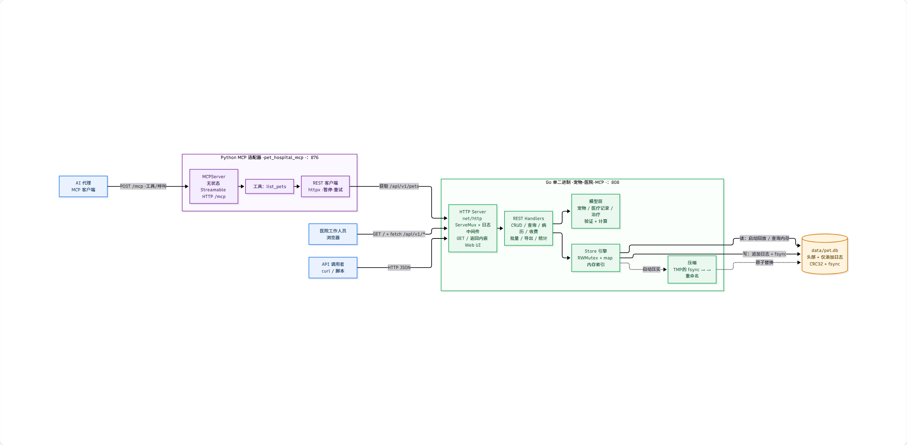
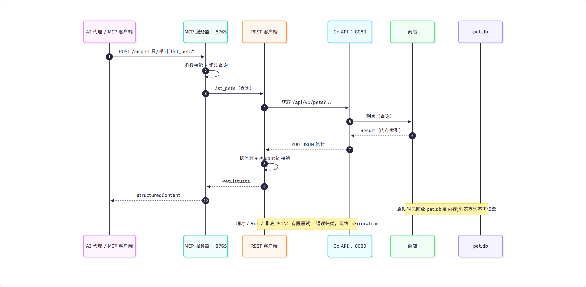
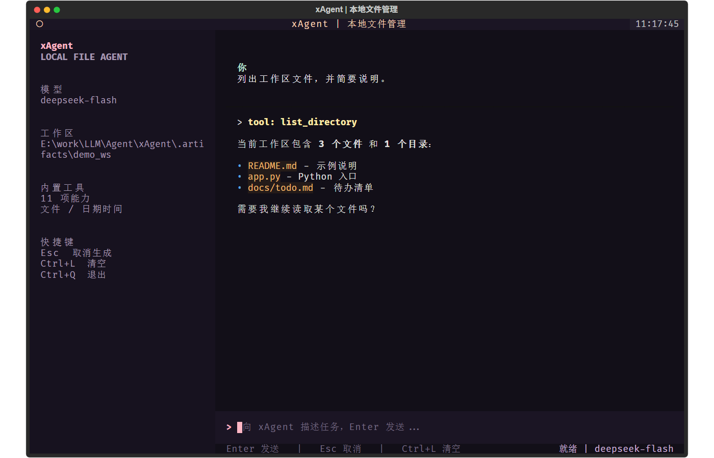

# Study · LLM 课程作业仓库

本仓库收录 LLM / MCP 方向的课程实践项目，围绕 **Go REST API → MCP 工具服务 → AnythingLLM 知识库** 这条主线展开。
每个子项目都可独立运行，仓库根目录统一管理。

| 项目 | 技术栈 | 定位 |
| --- | --- | --- |
| [Pet-hospital-MCP](#1-pet-hospital-mcp) | Go 1.22 / Python 3.11+ | 宠物医院系统 + MCP 工具服务（**第一个开发任务**） |
| [AnythingLLMMCP](#2-anythingllmmcp) | Python / MCP SDK | 查询 AnythingLLM 工作区文件元数据 |
| [AnythingLLMSever](#3-anythingllmsever) | 原生 HTML / JavaScript | 浏览器端 AnythingLLM 批量文档上传器 |
| [Agent](#4-agent) | Python / OpenAI SDK | 多轮对话 CLI，支持流式输出与工具调用 |
| [xAgent](#43-xagent) | Python / Textual / OpenAI SDK | Core/TUI 分层、文件工具、中文命令面板 |

---

## 目录结构

```text
Study/
├── .gitignore
├── README.md
├── Agent/                          # 任务 4：对话 Agent
│   ├── practice01/
│   │   ├── chat.py                 # 多轮对话 + 流式输出
│   │   └── config.ini              # 本地配置（已 gitignore，不提交）
│   ├── practice02/
│   │   ├── chat.py                 # 流式输出 + getdate 工具调用
│   │   ├── chat_isleapyear.py      # 在 chat.py 基础上新增 isleapyear 工具
│   │   ├── chat_file_tools.py      # 10 个文件 / 目录操作工具
│   │   └── config.ini              # 本地配置（已 gitignore，不提交）
│   └── xAgent/                     # Core/TUI 分层重构版
│       ├── core/                   # 业务核心：Agent、工具、配置、事件流
│       ├── tui/                    # Textual 终端界面
│       ├── tests/                  # 55 项核心与 TUI 测试
│       ├── docs/                   # 架构说明与界面预览
│       ├── config.example.ini
│       └── pyproject.toml
├── AnythingLLMMCP/                 # 任务 2：AnythingLLM MCP 服务
│   ├── server.py                   # MCP 服务器
│   ├── opencode.json               # opencode 的 MCP 注册配置
│   └── requirements.txt
├── AnythingLLMSever/               # 任务 3：网页上传工具
│   └── index.html                  # 单文件应用
└── Pet-hospital-MCP/               # 任务 1：宠物医院
    ├── pet-hospital-mcp/           # 连字符 → Go REST API（后端）
    │   ├── main.go
    │   ├── internal/
    │   │   ├── model/              # 数据模型与校验
    │   │   ├── store/              # 单文件嵌入式数据库引擎
    │   │   └── api/                # REST 路由 + 内嵌网页
    │   ├── Makefile / build.sh
    │   └── LICENSE
    ├── docs/diagrams/              # 架构图（.mmd 源文件 + 导出的 PNG）
    └── pet_hospital_mcp/           # 下划线 → Python MCP 服务（本层适配器）
        ├── src/pet_hospital_mcp/
        ├── scripts/verify_client.py
        └── tests/
```

> ⚠️ `Pet-hospital-MCP/` 下有两个名字极相似的目录，**只差一个字符**，进入时务必确认：
>
> | 目录 | 用途 |
> | --- | --- |
> | `pet-hospital-mcp/`（连字符） | Go 后端 REST API |
> | `pet_hospital_mcp/`（下划线） | Python MCP 服务 |

---

## 1. Pet-hospital-MCP

由两部分组成：**Go 编写的宠物医院 REST API**，以及把它包装成 AI Agent 可调用工具的 **Python MCP 服务**。
MCP 层是独立进程，只通过 HTTP 调用后端，**不修改后端一行代码**。



> 图 1：浏览器 / API 调用方 / AI Agent 三条入口，以及 Go 进程内部分层与存储读写路径。
> 源文件与更新方式见 [`docs/diagrams`](Pet-hospital-MCP/docs/diagrams/README.md)。

### 1.1 Go REST API（后端）

仅使用 **Go 标准库**，无任何第三方依赖，`go build` 即可完成。

| 能力 | 说明 |
| --- | --- |
| 网页操作界面 | 浏览器打开 `http://127.0.0.1:8080/` 即可增删改查，无需写代码 |
| REST 接口 | 29 个端点，覆盖查询 / 新增 / 删除 / 批量 / 导出 / 统计 |
| 单文件数据库 | `data/pet.db`，自研 append-only 日志 + CRC32 + 内存索引 |
| 崩溃安全 | 原子重写（临时文件 + `rename`）、`fsync` 落盘、损坏自动截断修复 |
| 内嵌网页 | 前端资源通过 `embed` 打进可执行文件 |
| 可迁移 | 只需「可执行文件 + `data/pet.db`」两个文件，目标机无需装 Go |

**启动：**

```bash
cd Pet-hospital-MCP/pet-hospital-mcp
go run . -seed -count 2000       # 8 条精选 + 2000 条随机模拟数据
# 或使用预编译发行包：dist/windows/pethospital.exe
```

**验证：**

```bash
curl -s http://127.0.0.1:8080/health
```

详细文档见 [`pet-hospital-mcp/README.md`](Pet-hospital-MCP/pet-hospital-mcp/README.md)。

### 1.2 Python MCP 服务（适配层）

把后端的 `GET /api/v1/pets` 暴露为 MCP 工具 `list_pets`。

| 项 | 值 |
| --- | --- |
| MCP Python SDK | `mcp==2.0.0` |
| 协议版本 | `2026-07-28` |
| 服务端实现 | `mcp.server.MCPServer`（SDK 2.x） |
| 传输方式 | 无状态 Streamable HTTP（`stateless_http=True`, `json_response=True`） |
| MCP 端点 | `POST http://127.0.0.1:8765/mcp` |
| 健康检查 | `GET http://127.0.0.1:8765/health` |
| 已实现工具 | `list_pets` |



> 图 2：一次 `list_pets` 调用从 MCP 客户端到 Go API 的完整链路（无状态 HTTP + 统一响应信封）。
> 注意启动时已把 `pet.db` 回放到内存，列表查询不再读盘。

**「无状态」的含义：** 不发送 `initialize`，不返回也不接受 `Mcp-Session-Id`，没有会话存储与 SSE 断点续传；每次 POST 都是自包含的请求—响应，服务重启不丢任何东西。

**安装与启动：**

```bash
cd Pet-hospital-MCP/pet_hospital_mcp
python -m venv .venv
.venv/Scripts/python.exe -m pip install -e ".[dev]"
.venv/Scripts/python.exe -m pet_hospital_mcp
```

**运行测试**（全部走 `httpx.MockTransport`，无需启动任何服务）：

```bash
.venv/Scripts/python.exe -m pytest -q
# 190 passed
```

**主要环境变量：**

| 变量 | 默认值 | 说明 |
| --- | --- | --- |
| `PET_HOSPITAL_BASE_URL` | `http://127.0.0.1:8080` | Go 后端根地址 |
| `MCP_HOST` / `MCP_PORT` | `127.0.0.1` / `8765` | MCP 服务监听地址与端口 |
| `MCP_REQUEST_TIMEOUT` | `10.0` | 单次上游请求超时（秒） |
| `MCP_MAX_RETRIES` | `2` | 上游失败后的额外重试次数 |
| `MCP_LOG_LEVEL` | `INFO` | 日志级别 |

完整说明（含 `list_pets` 的 14 个查询参数、6 类错误码、日志脱敏规则）见 [`pet_hospital_mcp/README.md`](Pet-hospital-MCP/pet_hospital_mcp/README.md)。

---

## 2. AnythingLLMMCP

把 [AnythingLLM](https://anythingllm.com/) 的工作区文件查询能力包装成 MCP 工具，
供 AI Agent 在对话中直接读取本地知识库的文档元数据。

**工具：** `get_first_workspace_files` —— 返回第一个工作区内所有文档的标题、文件名、
来源路径、词数、token 数、创建与更新时间等。

**配置环境变量：**

| 变量 | 必填 | 默认值 | 说明 |
| --- | --- | --- | --- |
| `ANYTHINGLLM_API_KEY` | ✅ | — | 在 AnythingLLM 设置页生成，缺失则启动即报错 |
| `ANYTHINGLLM_URL` | ❌ | `http://localhost:3001` | AnythingLLM 实例地址 |
| `HOST` / `PORT` | ❌ | `127.0.0.1` / `8080` | MCP 服务监听地址与端口 |

> API Key 仅从环境变量读取，**不写入代码或配置文件**。
> Windows 下推荐用图形界面的「环境变量」面板设置（`系统属性 → 环境变量 → 用户变量 → 新建`），
> 改完后需完全重启 opencode 才生效。

**启动：**

```bash
cd AnythingLLMMCP
pip install -r requirements.txt
python server.py
```

**在 opencode 中启用：** [`opencode.json`](AnythingLLMMCP/opencode.json) 已注册该 MCP，
使用 workspace 相对路径，换机器后无需修改：

```json
{
  "mcp": {
    "anythingllm": {
      "type": "local",
      "cwd": "AnythingLLMMCP",
      "command": ["python", "server.py"],
      "enabled": true
    }
  }
}
```

> ⚠️ 该服务默认监听 `8080`，与 Go 后端的默认端口相同。若两者同时运行，
> 请通过 `PORT` 环境变量错开。

---

## 3. AnythingLLMSever

单文件网页应用，用于向 AnythingLLM 批量上传文档并自动向量化到第一个工作区。
无需构建、无需后端，直接用浏览器打开 [`index.html`](AnythingLLMSever/index.html) 即可。

**功能：**

- 填写服务器地址与 API Key，支持多选文件批量上传
- 自动定位第一个工作区，逐个上传并汇报成功 / 失败与文档词数
- API Key 使用 `type="password"` 输入框，填写后存入浏览器 `localStorage`，**不落盘、不入库**

**使用：**

1. 打开 `index.html`
2. 填写 AnythingLLM 地址（默认 `http://localhost:3001`）与 API Key
3. 选择文件 → 点「上传并嵌入」

---

## 4. Agent

基于 OpenAI SDK 的多轮对话命令行程序，支持 **SSE 流式输出**、上下文记忆与 **function call 工具调用**。

**准备配置** `Agent/practice01/config.ini`（该文件已被 `.gitignore` 排除，不会提交）：

```ini
[llm]
api_key = sk-your-key
base_url = https://api.openai.com/v1
model = gpt-4o-mini
```

**运行：**

```bash
cd Agent/practice01
pip install openai
python chat.py
```

输入空行会被忽略；每轮回答结束后自动追加到 `messages`，实现多轮对话。

### 4.1 practice02：工具调用

在 `practice01` 的基础上加入 function call，工具调用与最终回答均为流式输出。

| 文件 | 工具 | 实现方式 |
| --- | --- | --- |
| `practice02/chat.py` | `getdate` | 调用本地 `date` 命令获取当前日期时间 |
| `practice02/chat_isleapyear.py` | `getdate` + `isleapyear` | `isleapyear` 用 Python 计算闰年（能被 4 整除且不能被 100 整除，或能被 400 整除） |
| `practice02/chat_file_tools.py` | 10 个文件 / 目录操作工具 | 纯 Python 标准库实现，路径限制在工作区内 |

`practice02` 复用 `practice01` 的 `config.ini` 格式，复制一份到 `practice02/` 下即可运行：

```bash
cd Agent/practice02
python chat.py                 # 支持 getdate
python chat_isleapyear.py      # 支持 getdate 与 isleapyear
```

> 流式响应中的 `tool_calls` 分片会按 `index` 聚合 `id` / `name` / `arguments`，聚合完成后执行工具，
> 再把 `role="tool"` 的结果回传给模型继续生成。

### 4.2 practice02：本地文件管理工具集

`chat_file_tools.py` 沿用 `chat_isleapyear.py` 的流式对话与 function call 结构，把工具扩展到 **10 个文件 / 目录操作**，
让模型通过对话完成浏览目录、读取文本、增删改文件等任务。

| 序号 | 工具 | 说明 |
| --- | --- | --- |
| 1 | `get_current_directory` | 获取启动时的工作目录 |
| 2 | `list_directory` | 列出目录内容，支持递归、文件大小与修改时间 |
| 3 | `get_file_type` | 扩展名、MIME、文本 / 二进制判断、编码、大小 |
| 4 | `read_text_file` | 读取纯文本，自动识别 UTF-8 / GB18030 / UTF-16，超长内容截断 |
| 5 | `create_file` | 按「目录 + 文件名」创建文件，可写入初始内容，默认不覆盖 |
| 6 | `edit_text_file` | 支持覆盖、追加、文本替换三种模式 |
| 7 | `create_directory` | 创建目录，默认递归创建父目录 |
| 8 | `delete_directory` | 递归删除目录，支持非空目录 |
| 9 | `delete_file` | 删除文件 |
| 10 | `rename_path` | 重命名文件或目录，兼容 Windows 仅大小写改名 |

**实现要点：**

- 只用 Python 标准库，不依赖 shell 命令，跨平台一致。
- 所有相对路径基于启动时的工作目录，并限制在该工作区内，阻止 `..` 与符号链接越界。
- 读取 / 编辑只接受纯文本，二进制文件会被拒绝并提示先用 `get_file_type` 查看类型；单文件读取上限 5 MB。
- 写入采用「临时文件 + 原子替换」，中途失败不会破坏原文件。
- 删除或重命名工作区根目录会被拒绝；工具执行失败会作为结果回传给模型，不中断对话。

**运行与自检：**

```bash
cd Agent/practice02
python chat_file_tools.py               # 进入对话，工作区就是当前目录
python chat_file_tools.py --self-test   # 不调用模型，直接验证 10 个工具（13 项检查）
```

### 4.3 xAgent

`Agent/xAgent` 是 `chat_file_tools.py` 的工程化重构版，把单文件脚本拆成
**core（业务核心）+ tui（Textual 表现层）** 两个主要目录。



**核心设计：**

- `core` 不依赖 Textual / Rich，不读写终端；Agent 只通过 `AgentEvent` 异步事件流向 UI 输出状态。
- `tui` 不直接操作文件、不创建 OpenAI 客户端，只消费核心事件。
- OpenAI、文件系统和 UI 之间通过 `ChatModel`、`ToolRegistry` 与事件契约解耦，便于以后增加 Web / Desktop 界面。
- 提供 **10 个文件工具 + 时间工具 + `fetchWeb` 网页抓取 + `searchweb` 网络搜索**，所有路径限制在工作区内。
- 支持多轮工具调用、工具错误回传、取消生成和历史回滚。

**TUI 功能：**

- opencode 风格无边框输入区、马卡龙配色、流式 Markdown 与工具调用卡片。
- `Ctrl+P` 打开全中文命令面板；`Ctrl+V` 直接粘贴系统剪贴板；`Ctrl+L` 清空；`Esc` 取消当前生成。
- Windows `cmd.exe` 启动时自动尝试切换黑体，减少中英文和边框错位。
- 窗口失焦后重新激活时自动重排会话，修复后台生成造成的错位。

**运行：**

```powershell
cd Agent/xAgent
py -3.11 -m venv .venv
.\.venv\Scripts\python.exe -m pip install -e ".[dev]"
Copy-Item config.example.ini config.ini
# 编辑 config.ini，填入 [llm] api_key
.\.venv\Scripts\xagent.exe --workspace .
```

**验证：**

```powershell
.\.venv\Scripts\python.exe -m pytest -q   # 55 passed
.\.venv\Scripts\ruff.exe check core tui tests
```

详细架构与扩展方式见 [`Agent/xAgent/README.md`](Agent/xAgent/README.md)
和 [`Agent/xAgent/docs/architecture.md`](Agent/xAgent/docs/architecture.md)。

---

## 安全约定

本仓库在初始化时做了凭证防护，若你要在此基础上继续开发，请遵守以下约定：

- **禁止**把 API Key、Token、密码写进任何会被提交的文件（`server.py`、`index.html`、`opencode.json` 等）
- 密钥一律通过环境变量或 `localStorage` 注入
- 根目录 `.gitignore` 已排除 `.env`、`.venv/`、`dist/`、`*.db`、`__pycache__/`、`*.pem` 等敏感与构建产物
- 如果不慎提交了密钥，仅删除文件是不够的（历史仍在），需 `git filter-repo` 重写历史并**立即吊销该密钥**

## 环境要求

| 项目 | 要求 |
| --- | --- |
| Go 后端 | Go 1.22+ |
| Python MCP 服务 | Python 3.11+ |
| AnythingLLM MCP | Python 3.10+ |
| Agent | Python 3.11+ |
| Node.js | 可选，仅 MCP Inspector 调试需要 |

## 安全边界

`pet_hospital_mcp` 与 `pet-hospital-mcp` **刻意不做**认证、权限与 CORS 校验，
因此只适合运行在**本机 / 内网**环境，请勿直接暴露到公网。

## 作者与许可

- 作者：[LLL-Ricar-9257](https://github.com/LLL-Ricar-9257)
- 许可：MIT License

> **致谢与来源说明**
>
> `Pet-hospital-MCP/pet-hospital-mcp/`（Go 宠物医院 REST API）为**第三方开源项目**，
> 原作者署名见 [`LICENSE`](Pet-hospital-MCP/pet-hospital-mcp/LICENSE)（Copyright (c) 2026 atfa）。
> 本仓库按 MIT 协议原样引用，未修改其源代码。
>
> 其余项目 —— Python MCP 服务（`pet_hospital_mcp/`）、`AnythingLLMMCP/`、
> `AnythingLLMSever/`、`Agent/` —— 为课程作业中在讲师提供的示例基础上自行开发完成。
>
> 如需二次分发该 Go 后端部分，请一并遵守其 MIT 许可条款并保留原作者署名。